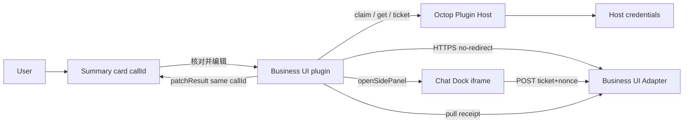
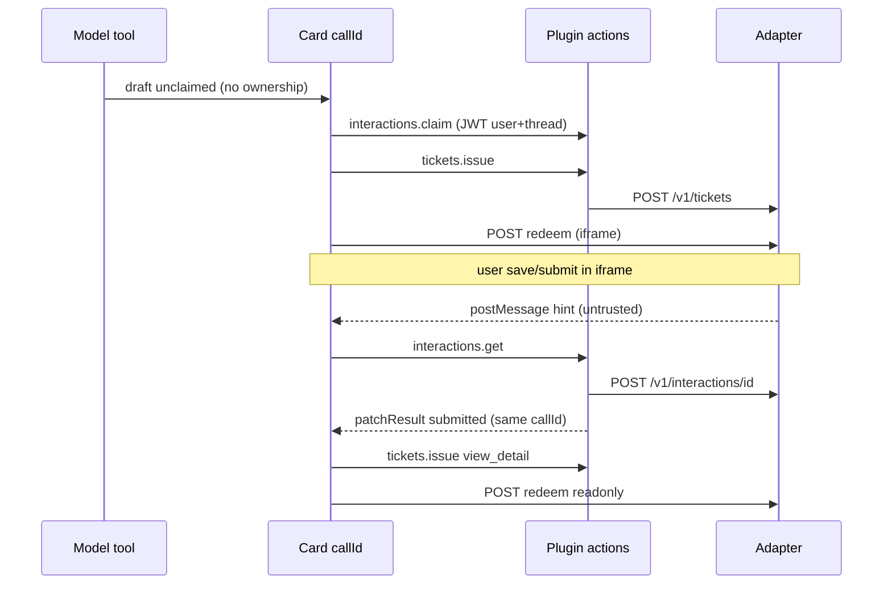

# business-ui.v1 协议

版本：`business-ui.v1`  
身份：Octop 插件（已认证 Host actions）↔ 外部 **Business UI Adapter**。  
本文件描述**泛化**契约。参考实现见 `plugins/business-ui/adapter/`（夹具，不是客户 ERP）。

## 架构



没有 Adapter→Octop 回调。收据一律由插件经已认证 action **拉取**。

## 七字段（卡片 / 交互状态）

| 字段 | 说明 |
|------|------|
| `documentType` | 逻辑单据类型 |
| `recordId` | 可空；提交后由业务签发 |
| `formRef` | 注册表逻辑名，**禁止模型 URL** |
| `schemaVersion` | 表单 schema |
| `recordVersion` | 乐观并发 |
| `allowedActions` | 展示用，**不是**安全门 |
| `interactionId` | 插件签发；认领前为 null |

另外：`submissionStatus` 与 `approvalStatus` **分开**。`save` ≠ `submit`。

## 主体命名空间

```json
{ "issuer": "https://octop.example.com", "sub": "https://octop.example.com|42" }
```

`issuer` 由管理员配置的本实例 HTTPS 源。`sub` = `issuer|local_user_id`。禁止跨实例用裸整数当全局用户。

## 出站约束（插件强制）

- 仅 HTTPS；禁止 URL 凭据与 fragment
- 不跟随重定向（或每一跳同等校验且凭据不跨源转发；本实现直接拒绝 3xx）
- DNS 解析后检查：云 metadata、链路本地、组播、未指定地址 **永远拒绝**
- 环回/私网仅当管理员写入 **显式** host/CIDR 例外
- 额外 origin 必须出现在该连接的批准列表
- TLS 校验（可附带部署 CA）；超时 8s；响应上限 256KiB
- Test Connection **非破坏**：`destructive: false`，不提交真实单据

## 握手 `POST {base}/v1/handshake`

请求：

```json
{ "protocol": "business-ui.v1", "destructive": false, "instance_issuer": "https://octop.example.com" }
```

成功响应：

```json
{
  "protocol": "business-ui.v1",
  "ok": true,
  "kind": "business-ui-adapter",
  "service": { "name": "reference-adapter", "environment": "fixture" },
  "auth": { "identity": "connection", "mode": "bearer" },
  "features": {
    "form_registry": true,
    "tickets": true,
    "receipts": true,
    "interactions": true
  },
  "ticket_path": "/v1/tickets",
  "redeem_path": "/v1/tickets/redeem",
  "interaction_path": "/v1/interactions/{id}",
  "resolve_path": "/v1/forms/resolve",
  "save_path": "/v1/documents/save",
  "submit_path": "/v1/documents/submit"
}
```

任意网站返回 HTML/登录页/HTTP 200 但 `kind` 不是 `business-ui-adapter` → **unsupported**，不是成功。  
`browser_embed` 阶段服务端恒为未评估（不绿灯）。

## 票据 `POST {base}/v1/tickets`

Bearer = 连接凭据（服务身份，不是用户 SSO）。

```json
{
  "protocol": "business-ui.v1",
  "subject": { "issuer": "https://octop.example.com", "sub": "https://octop.example.com|42" },
  "form_ref": "generic.request.edit",
  "record_id": null,
  "schema_version": "1",
  "record_version": 0,
  "action": "edit",
  "interaction_id": "int-…",
  "nonce": "…",
  "connection_id": "conn-…"
}
```

响应：短时一次性 `ticket` + **HTTPS** `redeem_url`（必须落在批准 origin）。不要把 ticket 放进查询字符串给用户书签。

## 兑票 `POST redeem_url`（浏览器，非 JSON）

`application/x-www-form-urlencoded`: `ticket`, `nonce`。  
一次性；重放 403。校验 issuer/audience/expiry/subject/form/record/actions（参考 Adapter 存于服务端票据记录）。  
成功：HttpOnly 会话 cookie（`SameSite=None; Secure`）+ HTML 表单。  
**不保证** 第三方 iframe 存储在所有浏览器可用。

## 保存 / 提交

`POST /v1/documents/save` 与 `POST /v1/documents/submit`  
必须带会话 cookie。业务端 **再次授权** 主体与操作。  
乐观并发：`record_version` 冲突 → 409。  
提交幂等：同一已提交单据重复 submit 返回 `idempotent: true`。  
iframe `postMessage` 仅为提示，不可信。权威状态来自下一节。

## 收据 `POST {base}/v1/interactions/{id}`

插件用连接凭据拉取：

```json
{
  "protocol": "business-ui.v1",
  "subject": { "issuer": "…", "sub": "…" },
  "call_id": "call-…"
}
```

成功：`success: true`，`status`（submission）、`approval_status`、`record_id`、`record_version`、`operation_id`、`navigation`、`subject_sub`。  
`subject_sub` 必须匹配当前 namespaced actor，否则插件丢弃。

## 时序：草稿 → 提交 → 同一卡片



## Host actions（插件）

| Action | permission | 作用 |
|--------|------------|------|
| `connections.list` | authenticated | 元数据列表，无密钥 |
| `connections.save` | admin | 增改连接 + 凭据 |
| `connections.delete` | admin | 停用并删除凭据 |
| `connections.test` | admin | 非破坏握手 |
| `interactions.claim` | authenticated | 绑定 callId↔用户↔线程 |
| `interactions.get` | authenticated | 拉收据并覆盖状态 |
| `interactions.cancel` | authenticated | 仅草稿 |
| `tickets.issue` | authenticated | 一次性页面票 |

无 scope（缺 `agent_id`/`thread_id`）时 claim/get/ticket **失败关闭**。
