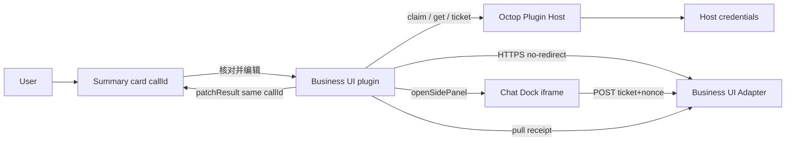
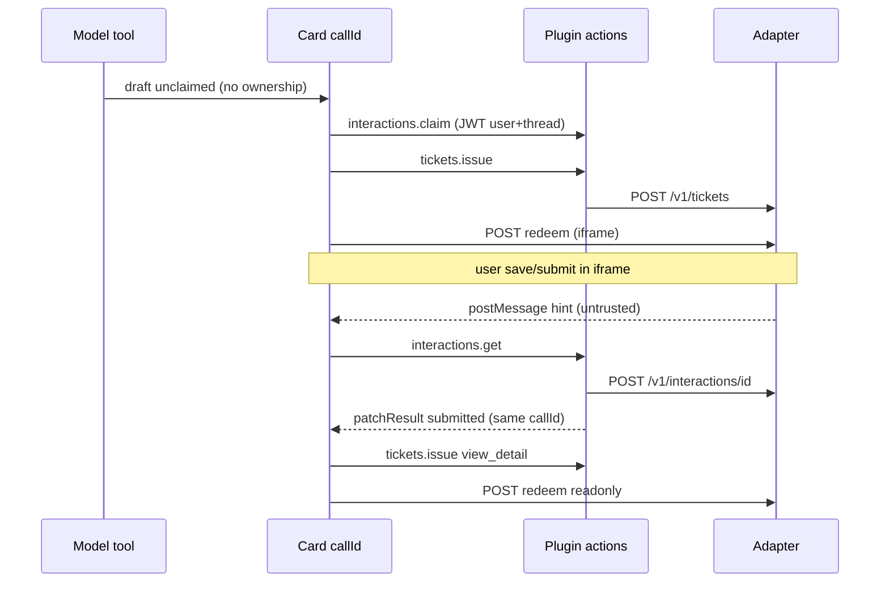

# business-ui.v1 协议

版本：`business-ui.v1`（收据信封 **1.1** 扩展，不替换七字段）  
身份：Octop 插件（已认证 Host actions）↔ 外部 **Business UI Adapter**。  
本文件描述**泛化**契约。参考实现见 `plugins/business-ui/adapter/`（夹具，不是客户 ERP）。

## 架构



没有 Adapter→Octop 回调。收据一律由插件经已认证 action **拉取**。

## 七字段（卡片 / 交互状态）

| 字段 | 说明 |
|------|------|
| `documentType` | 逻辑单据类型 |
| `recordId` | 可空；提交后由业务签发 |
| `formRef` | 注册表逻辑名，**禁止模型 URL** |
| `schemaVersion` | 表单 schema |
| `recordVersion` | 乐观并发 |
| `allowedActions` | 展示用，**不是**安全门 |
| `interactionId` | 插件签发；认领前为 null |

另外：`submissionStatus` 与 `approvalStatus` **分开**。`save` ≠ `submit`。

## 收据 1.1（扩展，不替换七字段）

在七字段之上增加：

| 字段 | 说明 |
|------|------|
| `operationId` | 业务操作 id；UNKNOWN 时用于 `queryStatus` |
| `result` | `{ type, status, code, message }` |
| `navigation` | 只读详情等导航（`formRef`，禁止任意 URL） |
| `summary` | 卡片摘要；敏感字段由插件掩码 |
| `receipt_sequence` | 与 `recordVersion` 一起排序，旧收据不得覆盖新状态 |

`formRef` / `schemaVersion` / `recordVersion` 仍为权威字段。

### result.type

| type | 卡片 | 按钮 |
|------|------|------|
| `SUCCESS` | 成功 | 有 `recordId` 才「查看正式单据」 |
| `BUSINESS_REJECTED` | 业务拒绝；仅展示可披露 `code`/`message` | **禁止** 未授权的 edit/submit/detail；未执行则不显示单号；后续拒绝 **不得抹掉已有 recordId** |
| `TECHNICAL_ERROR` | `status=FAILED`：已确认失败；仅当服务端声明 `safe_retry` 且无副作用/幂等时允许重试。`status=UNKNOWN`：不得显示成败、不得自动重提，只提供按 `operationId` 的 `queryStatus`，解析为成功/失败或继续 pending |

### 统一事件

`BUSINESS_OPERATION_SUCCESS` / `REJECTED` / `ERROR` / `RESOLVED`，以及 `DOCUMENT_VIEW_REQUESTED`。按 `interactionId` 更新**同一** `callId` 卡片（`patchResult`），禁止重复卡；相同 `operationId`+结果幂等；`recordVersion`/`receipt_sequence` 拒绝过期覆盖。卡片 `patchResult` 失败不影响后端记录。

### 按钮

只由服务端 `allowedActions` + 当前状态生成：`view_document`（需 `recordId`，出站再鉴权，经 `formRef`+`recordId` 兑票，禁止任意 URL）、`continue`、`request_permission`（仅当服务端提供）、`retry`（仅确认安全）、`query_status`（只查询不重提）、`close`。

成功且侧栏对该交互处于 edit 模式时，兑 `view_detail` 切只读详情；否则卡片保留「查看正式单据」。

没有 Adapter→Octop webhook。收据由已认证 action **拉取** / 有限轮询。超时标记 `TECHNICAL_ERROR/UNKNOWN`，不得静默保留过期成功态。

历史恢复：`interactions.lookup`（宿主校验的 `callId`+线程）读 `plugin_records` 再拉最新收据；允许短暂草稿闪烁；**不改写** `thread_messages`。

## 主体命名空间

```json
{ "issuer": "https://octop.example.com", "sub": "https://octop.example.com|42" }
```

`issuer` 由管理员配置的本实例 HTTPS 源。`sub` = `issuer|local_user_id`。禁止跨实例用裸整数当全局用户。

## 出站约束（插件强制）

- 仅 HTTPS；禁止 URL 凭据与 fragment
- 不跟随重定向（或每一跳同等校验且凭据不跨源转发；本实现直接拒绝 3xx）
- DNS 解析后检查：云 metadata、链路本地、组播、未指定地址 **永远拒绝**
- 环回/私网仅当管理员写入 **显式** host/CIDR 例外
- 额外 origin 必须出现在该连接的批准列表
- TLS 校验（可附带部署 CA）；超时 8s；响应上限 256KiB
- Test Connection **非破坏**：`destructive: false`，不提交真实单据

## 握手 `POST {base}/v1/handshake`

请求：

```json
{ "protocol": "business-ui.v1", "destructive": false, "instance_issuer": "https://octop.example.com" }
```

成功响应：

```json
{
  "protocol": "business-ui.v1",
  "ok": true,
  "kind": "business-ui-adapter",
  "service": { "name": "reference-adapter", "environment": "fixture" },
  "auth": { "identity": "connection", "mode": "bearer" },
    "features": {
    "form_registry": true,
    "tickets": true,
    "receipts": true,
    "interactions": true,
    "user_auth_methods": ["oauth2", "native_login", "personal_access_token"],
    "oauth_authorization_code": true,
    "oauth_pkce_s256": true,
    "receipt_schema_v11": true,
    "query_status": true,
    "safe_retry": true
  },
  "operation_path": "/v1/operations/{id}",
  "ticket_path": "/v1/tickets",
  "redeem_path": "/v1/tickets/redeem",
  "interaction_path": "/v1/interactions/{id}",
  "resolve_path": "/v1/forms/resolve",
  "save_path": "/v1/documents/save",
  "submit_path": "/v1/documents/submit"
}
```

任意网站返回 HTML/登录页/HTTP 200 但 `kind` 不是 `business-ui-adapter` → **unsupported**，不是成功。  
`browser_embed` 阶段服务端恒为未评估（不绿灯）。  
`features.user_auth_methods` 列出 Adapter **支持** 的用户授权方式（子集即可）。管理员在连接上选择的方式必须出现在该列表中，否则 Test Connection 失败关闭。列出 `oauth2` 时必须 `oauth_pkce_s256: true`。Casdoor 只是合规 IdP 之一，协议不绑定任何供应商。

## 用户授权（每位 Octop 用户单独激活）

服务凭据只证明 **Adapter 连接**。用户单据 API（票据、收据）使用 **该用户自己的令牌**。管理员登记连接时选择三种方式之一：

### 1. 标准 OAuth2 / OIDC（authorization code + PKCE S256）

可对接任意合规授权服务器。连接配置：

| 字段 | 说明 |
|------|------|
| `oauth_discovery_url` | 可选 RFC 8414 / OIDC discovery |
| `oauth_authorize_url` / `oauth_token_url` | 无 discovery 时必填 |
| `oauth_revoke_url` | 可选；断开时尽力撤销 |
| `oauth_client_id` / `oauth_client_secret` | 客户端；secret 进 Host 凭据 |
| `oauth_scopes` | 默认 `openid profile` |

**宿主没有插件 OAuth 回调。** 安全替代：Adapter 托管 `GET {base}/v1/oauth/callback`。流程：

1. `activations.start` 生成 `state` + PKCE `code_verifier`（Host 凭据，绑定当前 JWT 用户）
2. 用户弹出窗口打开 `authorization_url`（含 `state`、`code_challenge=S256`）
3. IdP → Adapter callback 保存一次性 `code`（按 state 索引）
4. 插件轮询 `activations.complete(state)`：用**服务凭据** `POST /v1/oauth/consume` 取 code，再在 token endpoint 用 verifier 换用户令牌
5. `state` 一次性；跨用户、过期、重放失败关闭

IdP 若与 Adapter 不同源，必须把 IdP origin 写入连接的额外 origin 列表。

### 2. 业务系统原生账号

插件表单收集用户名/密码，经已认证 `activations.native` POST 到 Adapter `POST /v1/auth/native`（服务 Bearer）。**密码不落盘**，只保存换回的用户令牌。

### 3. 个人访问令牌

用户在插件表单粘贴 PAT，经 `activations.pat` 交给 Adapter `POST /v1/auth/pat` 校验后写入该用户的 Host 凭据。令牌不进 URL/聊天/records/日志。

无论哪种方式：令牌 per-user、owner = 宿主校验的 `PluginActor.user_id`、刷新/撤销在对方支持时执行、失败关闭。未激活用户 claim/ticket 返回 `ACTIVATION_REQUIRED`（需要激活/重新激活）。

## 票据 `POST {base}/v1/tickets`

Bearer = **当前用户**访问令牌（不是连接服务凭据）。未激活或令牌失效 → 401。

```json
{
  "protocol": "business-ui.v1",
  "subject": { "issuer": "https://octop.example.com", "sub": "https://octop.example.com|42" },
  "form_ref": "generic.request.edit",
  "record_id": null,
  "schema_version": "1",
  "record_version": 0,
  "action": "edit",
  "interaction_id": "int-…",
  "nonce": "…",
  "connection_id": "conn-…"
}
```

响应：短时一次性 `ticket` + **HTTPS** `redeem_url`（必须落在批准 origin）。不要把 ticket 放进查询字符串给用户书签。

## 兑票 `POST redeem_url`（浏览器，非 JSON）

`application/x-www-form-urlencoded`: `ticket`, `nonce`。  
一次性；重放 403。校验 issuer/audience/expiry/subject/form/record/actions（参考 Adapter 存于服务端票据记录）。  
成功：HttpOnly 会话 cookie（`SameSite=None; Secure`）+ HTML 表单。  
**不保证** 第三方 iframe 存储在所有浏览器可用。

## 保存 / 提交

`POST /v1/documents/save` 与 `POST /v1/documents/submit`  
必须带会话 cookie。业务端 **再次授权** 主体与操作。  
乐观并发：`record_version` 冲突 → 409。  
提交幂等：同一已提交单据重复 submit 返回 `idempotent: true`。  
iframe `postMessage` 仅为提示，不可信。权威状态来自下一节。

## 收据 `POST {base}/v1/interactions/{id}`

插件用 **用户令牌** 拉取：

```json
{
  "protocol": "business-ui.v1",
  "subject": { "issuer": "…", "sub": "…" },
  "call_id": "call-…"
}
```

成功：`success: true`，`status`（submission）、`approval_status`、`record_id`、`record_version`、`operation_id`、`result`（1.1 `{type,status,code,message}`）、`navigation`、`summary`、`subject_sub`。  
`subject_sub` 必须匹配当前 namespaced actor，否则插件丢弃。超时/非 200 映射为 `TECHNICAL_ERROR`/`UNKNOWN`，不得静默保留过期成功态。

## 时序：草稿 → 提交 → 同一卡片



## Host actions（插件）

| Action | permission | 作用 |
|--------|------------|------|
| `connections.list` | authenticated | 元数据列表，无密钥 |
| `connections.save` | admin | 增改连接 + 凭据 |
| `connections.delete` | admin | 停用并删除凭据 |
| `connections.test` | admin | 非破坏握手；报告 `user_auth_methods` |
| `activations.start` | authenticated | OAuth2 开始 / 其它方式提示凭据表单 |
| `activations.complete` | authenticated | 消费 OAuth `state`（一次性） |
| `activations.native` | authenticated | 业务账号换用户令牌 |
| `activations.pat` | authenticated | 校验并保存 PAT |
| `activations.disconnect` | authenticated | 撤销本用户令牌 |
| `interactions.claim` | authenticated | 绑定 callId↔用户↔线程；需已激活 |
| `interactions.get` | authenticated | 拉收据并合并 1.1 结果 |
| `interactions.lookup` | authenticated | 按宿主 callId+线程恢复 |
| `interactions.query_status` | authenticated | 按 operationId 查询，禁止重提 |
| `interactions.retry` | authenticated | 仅 FAILED+safe_retry |
| `interactions.cancel` | authenticated | 仅草稿 |
| `tickets.issue` | authenticated | 一次性页面票 |

无 scope（缺 `agent_id`/`thread_id`）时 claim/get/ticket **失败关闭**。
